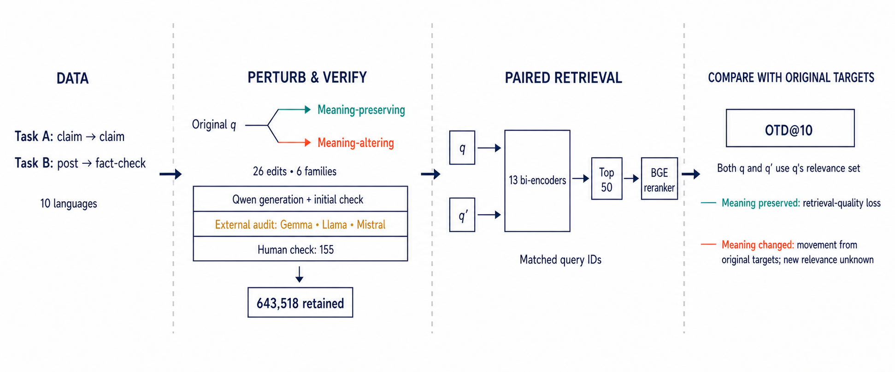

# Multilingual Claim Perturbation and Retrieval Robustness

Research code for generating, verifying, and evaluating multilingual claim
perturbations in claim-matching systems. The project supports two retrieval
tasks, 10 languages, 26 perturbation types, 13 embedding checkpoints, and an
optional cross-encoder reranking stage.



The repository contains code and documentation only. Raw datasets, generated
queries, model caches, and result files are intentionally excluded because of
their size and source-specific distribution terms.

## What is included

- A multilingual perturbation taxonomy combining model-based and deterministic
  edits.
- Preprocessing and resumable perturbation generation for MultiClaim claims and
  linked social-media posts.
- Structured verification through any OpenAI-compatible local endpoint.
- Dense retrieval and cross-encoder reranking for claim clustering and
  post-to-fact-check retrieval.
- Deterministic checks, multi-model verifier consensus, tokenization analysis,
  and compact verification summaries.

## Repository layout

| Path | Purpose |
| --- | --- |
| `perturbations/` | Data preparation, perturbation generation, prompts, and verification |
| `embeddings/` | Bi-encoder retrieval, reranking, model registry, and rank inspection |
| `analysis/` | Deterministic validation, verifier consensus, and tokenization analysis |
| `docs/` | Detailed methodology and the publication pipeline figure |
| `data/README.md` | Expected private data layout and input schemas |

## Requirements

- Python 3.10 or newer
- An OpenAI-compatible local inference server for model-based perturbations and
  verification
- A CUDA GPU for the embedding evaluation; the provided defaults were tuned for
  a high-memory GPU

Use separate environments for generation/verification and retrieval because
their dependency stacks differ.

```bash
python3 -m venv .venv
source .venv/bin/activate
python -m pip install --upgrade pip
python -m pip install -r perturbations/requirements-perturbator.txt
```

For verification, also install:

```bash
python -m pip install -r perturbations/requirements-verifier.txt
```

For retrieval, follow the CUDA notes in
[`embeddings/requirements.txt`](embeddings/requirements.txt). Model downloads
can be large, and some checkpoints may require accepting their upstream terms.

## Data setup

Place source files under `data/raw/` and generated files under
`data/processed/`. Exact filenames and required columns are documented in
[`data/README.md`](data/README.md). Do not commit raw posts, private mappings,
or model-generated datasets unless their licenses explicitly permit it.

## Quick start

### 1. Configure the local generation model

The generator reads its connection settings from environment variables:

```bash
export PERTURBATOR_BASE_URL=http://localhost:8000/v1
export PERTURBATOR_API_KEY=lm-studio
export PERTURBATOR_MODEL=unsloth/Qwen3.6-35B-A3B-NVFP4
```

The placeholder key is sufficient for LM Studio and similar unauthenticated
local servers. Use a real secret only through the environment; never commit it.

### 2. Preprocess the two task inputs

```bash
python perturbations/preprocess.py --dataset multiclaim
python perturbations/preprocess.py --dataset posts
```

Both commands accept `--input` and `--output` for non-default locations.

### 3. Generate perturbations

Start with a small balanced smoke test:

```bash
python perturbations/perturb_multiclaim.py --sample-per-lang 2 --workers 2
python perturbations/perturb_posts.py --sample-per-lang 2 --workers 2
```

Remove `--sample-per-lang` for a full run. Output files are resumable: completed
IDs are skipped when the same output path is reused.

### 4. Verify generated rows

Independent verification is recommended. The verifier intentionally refuses to
reuse the generator checkpoint unless `--allow-same-model` is supplied.

```bash
export VERIFIER_API_KEY=local
python perturbations/verify.py \
  --input data/processed/perturbed_multiclaim.csv \
  --output data/processed/multiclaimnet_verified.csv \
  --model YOUR_INDEPENDENT_MODEL \
  --base-url http://localhost:8100/v1 \
  --workers 8
```

Run `python perturbations/verify.py --help` for retry, resume, dry-run, and
progress options.

### 5. Run retrieval evaluation

Install the retrieval dependencies and ensure CUDA is available, then run a
small model group before the full registry:

```bash
MODEL_GROUP=anchors bash embeddings/run_gpu_pipelines.sh
```

Results are written to `results/multiclaimnet/` and
`results/multiclaimv2/`. Use `--no-rerank` on either Python pipeline to skip
cross-encoder reranking.

## Validation and analysis

Deterministic structural checks:

```bash
python analysis/deterministic_validate.py \
  --input data/processed/multiclaimnet_verified.csv \
  --summary-json analysis_outputs/deterministic_multiclaimnet.json
```

Merge four verifier outputs:

```bash
python analysis/merge_verifier_consensus.py \
  --qwen QWEN.csv --gemma GEMMA.csv --llama LLAMA.csv --mistral MISTRAL.csv \
  --output analysis_outputs/four_model_all.csv \
  --strict-output analysis_outputs/four_model_unanimous.csv \
  --summary-json analysis_outputs/four_model_summary.json
```

Build compact verification tables:

```bash
python analysis/build_verification_tables.py \
  --input-root ensemble_verification \
  --output-root analysis_outputs/verification_tables
```

More examples and file contracts are in [`analysis/README.md`](analysis/README.md)
and [`docs/pipeline_methodology.md`](docs/pipeline_methodology.md).

## Tests

The lightweight validation tests do not require model downloads:

```bash
python analysis/test_deterministic_validate.py
python -m py_compile perturbations/*.py embeddings/*.py analysis/*.py
```

Full end-to-end runs require the external datasets, local model endpoints, and
GPU environment described above.

## Reproducibility notes

- Record model revision hashes, inference-server versions, and environment
  package versions for every release run.
- Generated perturbations are stochastic. Preserve the generated CSVs and
  verifier outputs used for reported experiments.
- Meaning-altering edits do not automatically have new relevance judgments.
  Scores against the original relevance set measure movement from the original
  targets, not correctness for the edited claim.
- Dialect rewrites are synthetic model outputs and must not be presented as
  representative language produced by speakers of those varieties.

## Citation and license

A formal citation will be added with the associated paper. Until a `LICENSE`
file is added, the code remains publicly viewable but no reuse rights are
granted by default. Repository owners should choose an appropriate software
license before announcing the public release.
